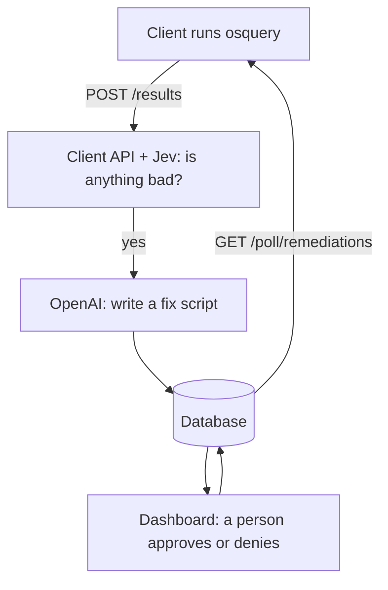

# How Boombox works

1. A new client registers once (`POST /api/v1/clients`) and gets a `client_id`.
2. Every few minutes, the client polls for queries to run (`GET /api/v1/poll/queries`).
3. The client runs the queries and sends back the rows (`POST /api/v1/results`).
4. Jev labels each row benign, suspicious or malicious.
5. If anything is flagged, OpenAI writes one bash or PowerShell script to fix it, and it's
   saved in the database as "pending review".
6. A person approves or denies it on the dashboard.
7. The client polls for approved fix scripts (`GET /api/v1/poll/remediations`) and runs
   them. Each one is marked executed as it's handed out, so it's only sent once.

The dashboard can also give one client extra queries, which it gets every time it polls for queries.

| Part | Language | Port | Folder | Owner |
|---|---|---|---|---|
| Client API | Python | 8080 | `server/client-api` | Andrew |
| Dashboard API | Go | 8000 | `server/dashboard-api` | Xander |
| Dashboard website | Vue | 5173 | `dashboard/` | Xander |
| Database | PostgreSQL | 5432 | `server/database` | Aiden |
| Clients | ? | | `client/` | Kade, Mateo |

The two APIs never call each other. They share the database.

## Infrastructure

We need three machines: a Linux client, a Windows client, and a Linux server. Ethan decides
whether they run on his Proxmox (shared over Tailscale) or in the CSRL server room.

## Tasks

### Linux client - Kade
- [ ] Learn osquery
- [ ] Register, then poll for queries: run them and `POST /api/v1/results`
- [ ] Poll for remediations and run the approved fix scripts
- [ ] Test the Linux queries in `server/client-api/ingest/queries.py` on a real machine

### Windows client - Mateo
- [ ] Same as Kade, for Windows

### Client API and AI models - Andrew
- [x] Client API: register, poll queries, poll remediations, results
- [x] Decision model (Jev) and remediation model (OpenAI)
- [x] Save fix scripts to the database for review
- [ ] Test with real client data

### Database - Aiden
- [x] PostgreSQL tables: clients, events, remediations, client queries
- [x] Sample data

### Dashboard - Xander
- [x] Show new fix scripts for review
- [x] Approve or deny each script
- [ ] `POST /api/v1/client-queries`: a query is saved as disabled unless the request sends
      `"enabled": true` (the original Python API defaulted to enabled)
- [ ] `GET /api/v1/remediations`: include `client_id` in each item

### Infrastructure - Ethan
- [ ] Decide between self-hosting and CSRL
- [ ] Set up the Linux client, Windows client and Linux server
- [ ] Give everyone access (Tailscale or another VPN)
