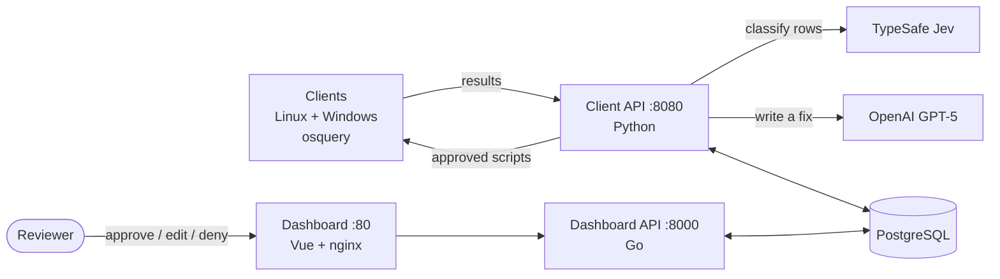

# How Boombox works

The full story of the project (steps, design decisions, problems and fixes, setup, and
references) is in [WRITEUP.md](WRITEUP.md).

More diagrams (one attack start to finish, the AI pipeline, a fix's life, the
infrastructure) are in [WRITEUP.md](WRITEUP.md#1-what-we-built).

1. A new client registers once (`POST /api/v1/clients`) and gets a `client_id`.
2. Every 10 seconds (by default), the client polls for queries to run (`GET /api/v1/poll/queries`).
3. The client runs the queries with osquery and sends back the rows (`POST /api/v1/results`).
4. Jev labels each row benign, suspicious or malicious.
5. If anything is flagged, OpenAI writes one bash or PowerShell script to fix the whole
   attack, and it's saved in the database as "pending review".
6. A person approves, edits, or denies it on the dashboard.
7. The client polls for approved fix scripts (`GET /api/v1/poll/remediations`) and runs
   them. Each one is marked executed as it's handed out, so it's only sent once.

The dashboard can also give one client extra queries, which it gets every time it polls for queries.

| Part | Language | Port | Folder | Owner |
|---|---|---|---|---|
| Client API + AI | Python (FastAPI) | 8080 | `server/client-api` | Andrew |
| Dashboard API | Go | 8000 | `server/dashboard-api` | Xander |
| Dashboard website | Vue | 80 | `dashboard/` | Xander |
| Database | PostgreSQL | 5432 | `server/database` | Aidan |
| Linux client | Go | | `client/linux` | Kade |
| Windows client | Go (and an earlier Python version) | | `client/windows-client` | Mateo |
| Infrastructure | Proxmox, Docker, Tailscale | | | Ethan Simon |
| Live demo | Docker | | `demo/` | Andrew |

The two APIs never call each other. They share the database.

## Infrastructure

Everything runs on virtual machines on a Proxmox server (`us-heritage-1`), reached over
Tailscale. The clients only make outgoing requests, so they need no open ports:

- **Server** (`CYBER-344-Server`, Linux): runs the whole backend with `docker compose up`.
- **Linux client** (`cyber-344`): runs Kade's client as a systemd service.
- **Windows client** (`DESKTOP-S3G51BE`): runs Mateo's client as a Windows service (NSSM).

## Who did what

**Andrew Sabolsky: client API, AI pipeline**
- Set up the repository structure, the documentation, and the task split.
- Built the client API (`server/client-api`): registration, polling for queries and fix
  scripts, and receiving results.
- Built the AI pipeline: TypeSafe Jev to classify every row, OpenAI to write fix scripts,
  grouping findings into one fix per attack, filtering out Boombox's own traffic,
  and automatic checks on every script.
- Merged everyone's parts into one layout, put the whole backend in Docker Compose, and
  made the dashboard website survive restarts (nginx).
- Built the live demo (`demo/`).

**Kade Onines: Linux client**
- Built the Linux client in Go (`client/linux`): runs the server's osquery queries, sends
  the results, registers when it starts, and runs approved fix scripts.
- Set it up as a systemd service with restart on failure, and added detailed logging.
- Wrote the first project task list.

**Mateo Vallejo: Windows client**
- Built the Windows client, first in Python (`Windows-client-py`), then in Go for speed
  (`Windows-client-go`): registration, query and remediation polling with retries and
  backoff, and running approved fixes as PowerShell.
- Packaged it as a Windows service with NSSM, with install and uninstall scripts that lock
  down its folder to administrators.

**Aidan McEwan: database**
- Designed the PostgreSQL schema (`server/database/schema.sql`): clients, events,
  remediations (with their review status), and per-client queries.
- Wrote the database functions the client API uses (`storage/database.py`) and the
  first remediations API, which was later folded into the client API.

**Xander Whitby: dashboard**
- Built the dashboard API in Go (`server/dashboard-api`) on the shared database.
- Built the Vue dashboard website: review queue, backlog, analytics dashboard, and clients
  page; approve, deny, and edit fix scripts before they run; client columns everywhere.

**Ethan Simon: infrastructure**
- Set up the Proxmox virtual machines for the server and both clients, and network access
  for the team.
- Made every Docker service restart automatically (`restart: unless-stopped`).
- Fixed the server VM's CPU setting so the dashboard could build there (see the write-up).
