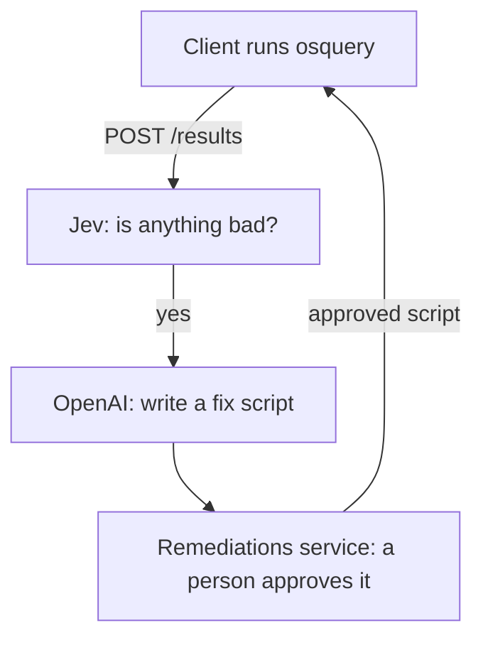

# How Boombox works

1. Every few minutes, the client asks the server which osquery queries to run (`GET /poll`).
2. The client runs them and sends back the rows (`POST /results`).
3. Jev labels each row benign, suspicious or malicious.
4. If anything is flagged, OpenAI writes one bash or PowerShell script to fix it.
5. The script goes to the remediations service, where a person approves or denies it on the dashboard.
6. Approved scripts are sent to the client, which runs them and reports the result.

The dashboard can also send a one-time custom query to one client.

Request and response formats are in [server/README.md](../server/README.md).

## Infrastructure

We need three machines: a Linux client, a Windows client, and a Linux server. Ethan decides
whether they run on his Proxmox (shared over Tailscale) or in the CSRL server room.

## Tasks

### Linux client - Kade
- [ ] Learn osquery
- [ ] Build the poll loop: `GET /poll`, run the queries, `POST /results`
- [ ] Run approved fix scripts and report the result back
- [ ] Test the Linux queries in `server/ingest/queries.py` on a real machine

### Windows client - Mateo
- [ ] Same as Kade, for Windows

### Backend API and AI models - Andrew
- [x] API format for clients (`GET /poll`, `POST /results`)
- [x] Decision model (Jev) and remediation model (OpenAI)
- [x] Custom queries for one client
- [ ] Test both models with real client data

### Remediations service - Aiden
- [ ] Receive fix scripts from the backend API (`POST /remediations`, format in `server/README.md`)
- [ ] Store them in PostgreSQL
- [ ] Show new fix scripts on the dashboard as they come in (with Xander)

### Dashboard - Xander
- [ ] Browser UI that shows new fix scripts for review
- [ ] Approve or deny each script
- [ ] Send approved scripts to clients (with Kade and Mateo)

### Infrastructure - Ethan
- [ ] Decide between self-hosting and CSRL
- [ ] Set up the Linux client, Windows client and Linux server
- [ ] Give everyone access (Tailscale or another VPN)
